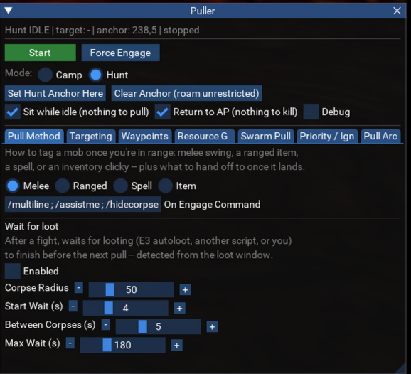
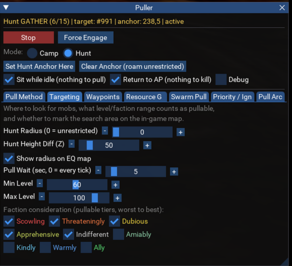
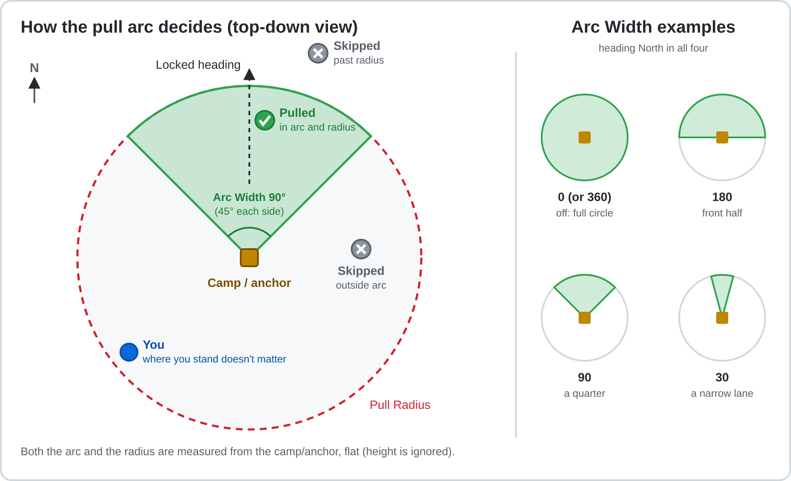
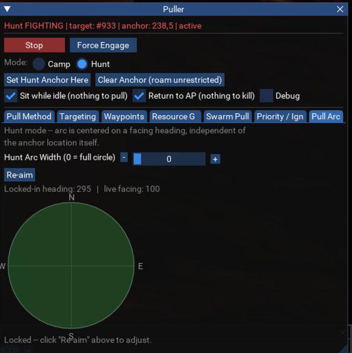
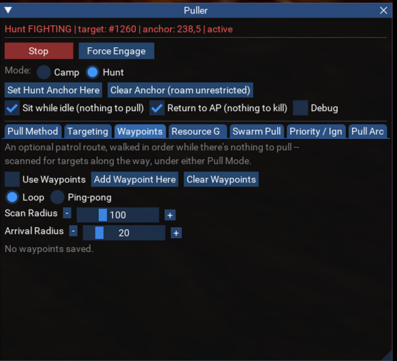
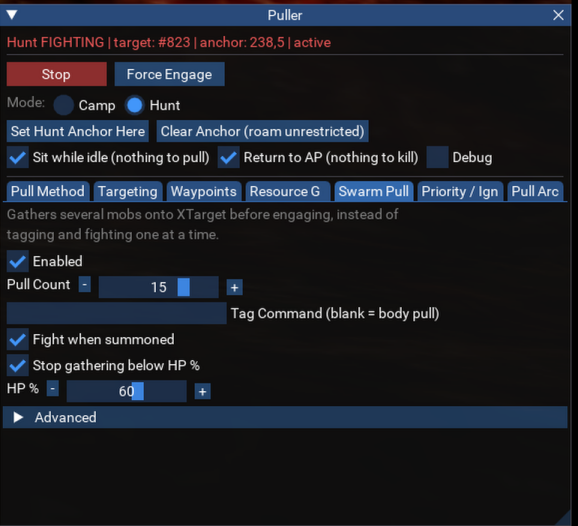
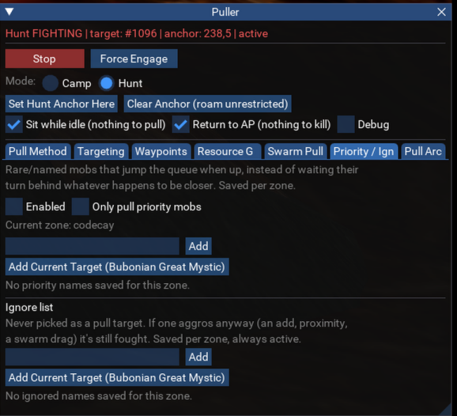
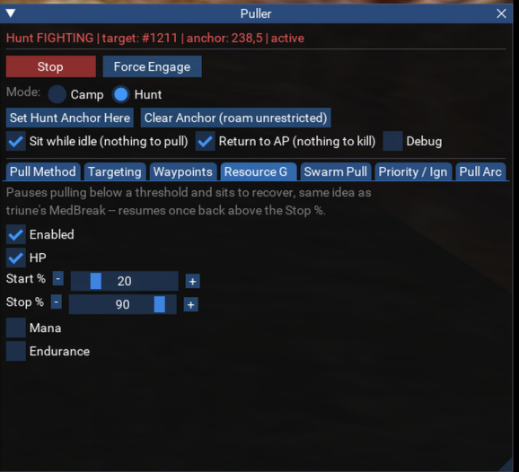

# Puller

Puller is a standalone MacroQuest Lua script that finds a mob, tags it, and then either drags it
back to camp or fights it where it stands. It deliberately does **not** run spell, ability or
discipline rotations. It gets you into the fight and then hands combat to you or to your own
combat script (for example `/assistme`, `/cleartargets stick`, or E3Next).

It started as the Puller (Camp) feature inside a larger `triune.lua` plugin suite and was
rewritten from scratch as its own script.

## Requirements

- [MacroQuest](https://www.macroquest.org/) with Lua scripting support.
- [MQ2Nav](https://www.macroquest.org/), with a navmesh loaded for your current zone. Pulling,
  dragging mobs home, and choosing which mob is closest all depend on it.
- Optional: a combat script or boxing framework to hand fights off to, through the
  **On Engage Command** setting. See
  [Using Puller with a combat script](#using-puller-with-a-combat-script).

## Installation

Put `puller.lua` in your MacroQuest `lua/` folder, then run:

```text
/lua run puller
```

The UI window opens automatically. Settings are saved per character to
`puller_<CharacterName>.lua` in your MacroQuest config folder and reload the next time you run
the script.

## Commands

| Command | What it does |
| --- | --- |
| `/puller start` (or `resume`) | Start pulling |
| `/puller stop` (or `pause`) | Stop pulling and cancel any movement in progress |
| `/puller status` | Print the current state to the console |
| `/puller help` | List all commands in the console |
| `/puller mode camp` / `/puller mode hunt` | Switch Pull Mode |
| `/puller setcamp` / `/puller clearcamp` | Set the camp to your position and facing, or clear it |
| `/puller setanchor` / `/puller clearanchor` | Set the Hunt anchor to your position and facing, or clear it (roam unrestricted) |
| `/puller radius <n>` | Set the Pull Radius (Camp, 10-1000) or Hunt Radius (0-1000, 0 = whole zone) for the current mode |
| `/puller style melee\|ranged\|spell\|item` | Set the pull method |
| `/puller engage <command>` | Set the On Engage Command (`engage clear` blanks it, `engage` alone shows it) |
| `/puller fightend <command>` | Set the On Fight End Command (`fightend clear` blanks it, `fightend` alone shows it) |
| `/puller ksguard on\|off` | Turn the KS guard on or off |
| `/puller stats` / `/puller stats reset` | Print the session stats, or start them over |
| `/puller addwp` / `/puller clearwp` | Add a waypoint at your position, or clear all waypoints |
| `/puller swarm on\|off` | Turn Swarm Pull on or off |
| `/puller swarm count <n>` | Set the Swarm Pull count (1-20) |
| `/puller lootwait on\|off` | Turn Wait for loot on or off |
| `/puller debug on\|off` | Turn Debug mode on or off |
| `/puller priority on\|off` | Turn the Priority Kill List on or off |
| `/puller priorityonly on\|off` | Turn "Only pull priority mobs" on or off |
| `/puller priority add\|remove [name]` | Add or remove a name on this zone's priority list |
| `/puller ignore add\|remove [name]` | Add or remove a name on this zone's Ignore list |
| `/puller priority list` / `/puller ignore` | Print this zone's list |
| `/puller show` / `hide` / `toggle` | Show or hide the Puller window (brings it back after closing it with the X) |
| `/puller force` (or `forceengage`) | Start fighting your current target immediately |
| `/pullerexit` | Exit the script |

Notes:

- **On/off commands:** leaving off `on`/`off` flips the setting.
- **List commands:** with no name, `add` and `remove` use your current target, which makes
  `/puller ignore add` a quick hotkey for skipping a mob. Names can contain spaces, for example
  `/puller priority add an eerie chest`.

Most of these also have a button or control in the UI window.

## How it works

Puller runs a simple state machine: **IDLE → TO_MOB → TO_CAMP → FIGHTING**, then back to IDLE
once nothing hostile is left.

- **Hunt mode** skips TO_CAMP and fights each mob where it was tagged.
- **Swarm Pull** inserts a **GATHER** state after IDLE, which collects several mobs before the
  fight starts.

## Features

### Pull modes

- **Camp** drags every tagged mob back to one fixed spot.
- **Hunt** fights each mob where it was tagged. You can roam freely, or stay within an anchor
  point and radius.

### Pull methods



**Melee, Ranged, Spell or Item.** Puller moves into that method's range, tags the mob, and
confirms aggro before dragging it home or fighting it in place.

- **Melee** stays under Puller's control for the whole fight. It closes distance, keeps you
  facing the mob, and moves to the nearest mob on your extended target list (XTarget) when the
  current one dies or can't be reached.
- **Melee range:** Puller moves you to about 65% of melee range but only counts you as out of
  range past about 90%. You end up in the middle of melee range instead of on its edge, so a mob
  shifting half a step doesn't put abilities like Flying Kick out of reach. Distances include
  height, which matches how the game checks range on slopes and stairs.
- **Ranged, Spell and Item** hand the fight to your combat script once it starts.
- **Spell** only casts when the spell is ready, so a pull spell on cooldown isn't spammed. If
  the spell isn't memorized, Puller says so in the console every 10 seconds.

### On Engage Command

On Engage Command runs whatever you put in it (for example `/assistme`) when a fight begins.

- **With Melee**, it runs each time your melee target changes, so your group follows the mob
  you're actually hitting.
- **With other pull methods**, it runs once for each new mob on XTarget. Runs are spaced a few
  seconds apart so they don't flood your combat script.
- **Setup per script:** see [Using Puller with a combat script](#using-puller-with-a-combat-script)
  for E3Next, triune.lua and KissAssist.
- **Several commands** can go in one line with MacroQuest's `/multiline`:

  ```text
  /multiline ; /assistme;/hidecorpse all
  ```

### On Fight End Command

On Fight End Command runs whatever you put in it once each time a fight ends, meaning nothing
is left attacking you. Use it for a loot command, telling your boxes to med, or a group tell. It
runs before [Wait for loot](#wait-for-loot) starts, so a loot command it sends is what that wait
then sees. `/multiline` works here too. Leave it blank to do nothing.

### Targeting



- **Pull Radius / Hunt Radius and Height (Z):** how far out from your camp or anchor to look for
  mobs, and how far up or down. Both radii go up to 1000. In Hunt mode, a radius of **0 means the
  whole zone**.
- **Min/Max Level and Faction Consideration:** limit which mobs can be pulled, by level and by
  con tier (color-coded from worst to best). Con is read by sending `/consider` and capturing the
  chat reply, because `ConColor()` isn't reliable on every server. The faction filter applies to
  normal pulls and to Swarm Pull gathering.
- **Closest by walking distance:** the next mob is chosen by MQ2Nav path length, not straight-line
  distance. A mob on the other side of a wall that would need a long walk around loses to one
  that's farther in a straight line but easy to reach. The scan stops as soon as no remaining mob
  can beat the shortest walk it has found, so it stays cheap.
- **Pull Wait:** limits how often Puller rescans once the area is empty. This is mainly for
  camping a named mob through a long respawn. It never delays reacting to a mob that attacks you,
  and never delays picking a new mob right after the previous one was dropped.
- **Show radius on EQ map:** draws circles on the native EQ map (through MQ2Map's `/maploc`),
  pinned to the camp or anchor point rather than to you. The pull radius is red. In Camp mode,
  the Camp Safe Radius is green.

#### KS guard

**KS guard** is on by default. It keeps Puller off mobs someone else is already fighting:

- **Damaged mobs:** a mob below 100% HP is never picked.
- **Other players nearby:** a mob with a player who isn't in your group within **Other Player
  Radius** (default 40) is skipped. Set the radius to 0 to use the HP check only.
- **While walking over:** if the mob takes damage before you tag it, Puller drops it and picks
  another. After your own tag fires, damage is assumed to be yours.
- **Pulling only:** a mob that aggroes on you anyway is still fought.

EQ doesn't report who an arbitrary mob is fighting, so HP and nearby players are the signals
Puller has.

### Camp Safe Radius

Camp Safe Radius is a Camp mode setting with a default of 30 (0 turns it off).

- **Holding at camp:** once a drag reaches camp, you stay on the camp spot. Melee only goes after
  mobs that have come within this distance of the camp point, so you don't run straight back out
  to the nearest mob on XTarget.
- **Delayed engage:** On Engage Command waits until a mob is inside the radius, so your group
  isn't sent out after it either.
- **Force Engage** ignores the radius.

### Pull arc



The pull arc works like KissAssist's `/setpullarc`: it limits pulls to a cone in one direction
instead of the full circle.

- A mob is pulled only if it's inside **both** the pull radius and the arc. **Arc Width** is the
  whole slice (90 means 45° each side of the heading), and 0 turns the arc off.
- The arc is measured from the camp or anchor, not from you, and height is ignored. It only
  decides what gets pulled: a mob outside it that aggroes anyway is still fought.



- The Pull Arc tab has a live preview that turns with you while you aim.
- **Lock Heading** commits the direction and **Re-aim** lets you change it. Aiming is separate
  from the camp or anchor location, so you can re-aim without standing on your camp spot again.

### Waypoint patrol



A waypoint patrol is a list of saved points that Puller walks in order while there's nothing to
pull. It can loop or go back and forth between the ends, and it scans for mobs along the way.
It works in either Pull Mode.

Each waypoint has two optional settings:

- **Cmd** runs once when you arrive at that waypoint. Leave it blank to do nothing. `/multiline`
  works here too.
- **Delay (s)** is how long to wait at that waypoint before moving on. The default is 0, meaning
  no wait. Puller still pulls anything that shows up while it's waiting.

### Swarm Pull



Swarm Pull gathers a set number of mobs onto XTarget **before** the fight starts, instead of
tagging and fighting one mob at a time.

- **Body pull by default:** Puller walks into range and lets EQ's own proximity aggro do the
  rest. It deals no damage, so nothing gets a chance to summon you mid-gather. You can set a tag
  command for each candidate if you'd rather accept that risk.
- **Fight When Summoned:** if you get summoned anyway, the gather ends immediately and Puller
  fights, or heads back to camp, with whatever has aggro, even if that's fewer than the count.
- **Stop Gathering Below HP%:** the same early exit, triggered when your own HP drops too low.
- **Fights start close:** when a gather ends, melee starts on the nearest mob that's already
  attacking you, not on the candidate it was still walking toward.
- **Works in either mode:** Hunt fights the whole group in place. Camp drags the whole group
  home.

### Wait for loot

Wait for loot is off by default and lives at the bottom of the Pull Method tab. After a fight, Puller holds off on
the next pull, on Return to AP, and on sitting while something is looting: E3 autoloot, another
script, or you. It works by watching the game's loot window, because E3Next doesn't expose a
"looting" state.

- **Before looting starts:** if NPC corpses are within **Corpse Radius** (default 50, 20 up or
  down, the same as E3's corpse search), it waits up to **Start Wait** (default 4 s) for looting
  to begin.
- **During looting:** it holds while the loot window is open, and for **Between Corpses**
  (default 5 s) after each close, while the looter moves to the next corpse.
- **Limits:** **Max Wait** (default 180 s) caps a single wait. Anything attacking you ends the
  wait immediately.

### Priority Kill List



The Priority Kill List is for rare or named mobs that should be pulled ahead of whatever happens
to be closer. Lists are saved **per zone**.

A priority mob still has to pass your level, faction, radius and arc filters. Being on the list
only means it wins the pick when it's up and eligible.

- **Only pull priority mobs:** with the list enabled, Puller never picks anything that isn't on
  this zone's list. If nothing on the list is up, or the list is empty, nothing gets pulled. Mobs
  that aggro on their own are still fought.

### Ignore list

The Ignore list is on the same Priority / Ignore tab and is also saved per zone. Names on it are
never chosen as pull targets. It only affects pulling: if an ignored mob aggroes anyway (an add,
proximity aggro, or a Swarm Pull drag), it's fought like anything else. If a name is on both
lists, Ignore wins.

### Resource Gate



The Resource Gate stops new pulls when HP, Mana or Endurance (whichever you turn on) is at or
below a "start" percentage. Pulling resumes once that resource is back above a higher "stop"
percentage. You sit to recover in between.

**Group** mana and HP use the same start and stop thresholds, measured on the lowest group member
who is in the zone, online and alive. This is mainly for waiting on your healer. Mana only counts
members who have mana. The tab shows who is lowest right now, and the status line names them
while you rest, for example `RESTING (Clericname at 15% mana)`.

### Quality of life and safety

- **Sit while idle:** sit and regenerate when there's nothing to pull.
- **Return to AP:** walk back to the camp or anchor point before sitting, instead of sitting
  wherever the last mob died.
- **Force Engage:** manual override for a pull that's stuck. It skips straight to fighting your
  current target.
- **Line-of-sight checks:** being in range isn't enough. Puller also checks line of sight, moves
  in close or backs off to try another angle when something blocks it, and switches to a
  different mob if the current one can't be reached for too long.
- **Missing XTarget entries:** XTarget sometimes fails to list a mob that's attacking you. When
  that happens, Puller checks whether your current target is hitting back, and reads the
  attacker's name from the combat log.
- **Per-zone camps:** the camp and hunt anchor are saved per zone and restored when you come
  back. Zoning while pulling pauses Puller; `/puller start` resumes.
- **Session stats:** XP, AA, kills and plat per hour, under the status line. See
  [Session stats](#session-stats).
- **Debug mode:** prints a status line to the console every couple of seconds, with the state,
  the mob it's after, distance, line of sight, combat flags, XTarget and swarm counts, the
  anchor, radius and arc in use, and your HP. Use it to see why Puller is or isn't doing
  something.

### Session stats

The line under the status line shows session stats since the script started, or since you
clicked **Reset**: XP (percent of a level per hour), AA per hour, kills, and plat. `/puller stats`
prints the same line.

- **Kills** are hostile mobs from your XTarget that died. A mob that despawns or runs off isn't
  counted.
- **Plat** is the change in the coin you're carrying, so buying, selling and banking count too.

## Using Puller with a combat script

Puller finds mobs and gets you into the fight. Your combat script runs the rotation. The handoff
is the **On Engage Command** box: Puller runs whatever you put there exactly as typed, and
`/multiline` lets you send several commands at once. Some scripts don't need a command at all,
because they start fighting on their own once you're in combat.

**The one rule for any script: only one thing should move you during a fight.**

- **Pull style Melee:** Puller keeps targeting, walking you to mobs and facing them for the
  whole fight. Turn off your combat script's own chase, stick and follow on the puller
  character.
- **Ranged, Spell or Item:** Puller stops controlling you once the fight starts, so your combat
  script can move you.
- **Pulling:** never run your combat script in a pulling or hunting role at the same time as
  Puller. Both would try to pick targets and move you.

### E3Next

- **On Engage Command:** `/assistme` sends your E3 bots to assist on your current target. With
  Melee it runs each time your target changes, so the group stays on the mob you're hitting.
  Example with an extra command:

  ```text
  /multiline ; /assistme;/hidecorpse all
  ```

- **ClearXTargets instead:** you can use `/cleartargets stick` (or similar) instead. With
  Ranged, Spell or Item, Puller reads E3's ClearXTargets state and won't announce a mob that E3
  is already stuck to.
- **Puller character:** make sure it isn't set to follow or chase another character in E3.
- **Autoloot:** if E3 autoloot is on, turn on **Wait for loot** so Puller doesn't pull you away
  from the corpses.

### triune.lua (with tac)

- **Mode:** run triune in **Manual** mode (`/ac manual`). In that mode it fights mobs that are
  attacking you or your pet, plus XTarget mobs engaged with your side within its chase range,
  so On Engage can stay blank. (`tac` is triune's add-on suite of HUDs, loot and similar. The
  rotation itself is in `triune.lua`.)
- **With Melee:** turn off triune's own sticking with `/ac manualstick off` so it doesn't chase
  mobs while Puller is moving you. Leave `/ac manualnav` off (its default).
- **Don't use triune's Puller or Assist modes** alongside Puller.
- **Group:** you can still put `/assistme` or another group command in On Engage for your
  other characters.

### KissAssist

- **Role:** run KissAssist in **Manual** role. You control movement and targeting, and
  KissAssist handles abilities, discs, heals and buffs on your current target once you're
  fighting. Puller's Melee style already turns auto-attack on, so On Engage can be blank, or
  `/attack on` to be sure.
- **Avoid** the Puller, PullerTank and Hunter roles, because they pick targets and move you.
- **Tank role** can work in Camp mode, but only if KissAssist's camp matches Puller's and its
  return-to-camp and chase settings are off. Otherwise it pulls you back to its own camp spot.
- Role names and settings differ between KissAssist versions, so check your version's
  documentation.

## Out of scope

Puller finds a mob, tags it, and drags it home or fights it. It is not a full combat script and
does not include:

- hazard avoidance
- recovery when you're cut off from the navmesh
- ladder climbing
- retracing your steps after getting lost
- pull coordination across multiple boxes
- spell loadouts or combat rotations

Navigation is a plain `/nav id|loc`. If there's no progress for a while, Puller tries once to
get unstuck and then skips that mob for a short time. There's no full stuck-recovery system.

## Credits

The pull logic and several conventions (heading math, unstuck moves, the start/stop thresholds
of the Resource Gate) were ported and adapted from a larger `triune.lua` plugin suite. Swarm
Pull's gather, fight and summon-abort design was adapted from that suite's `tac/swarm_pull.lua`
plugin.
